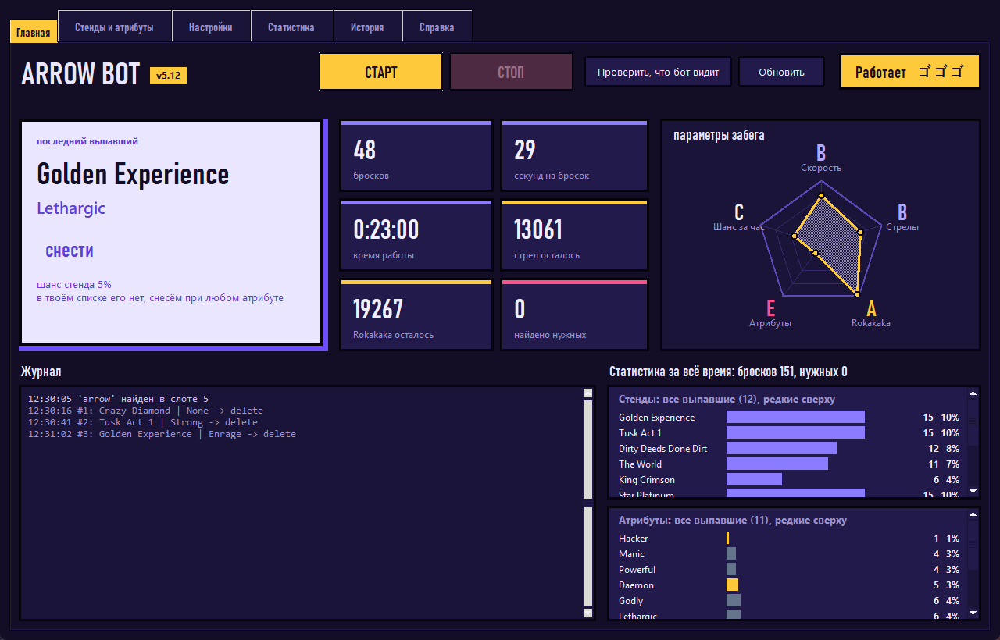
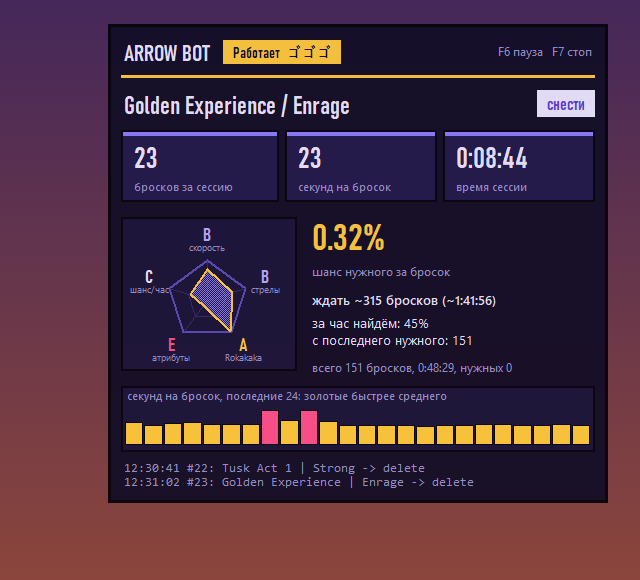
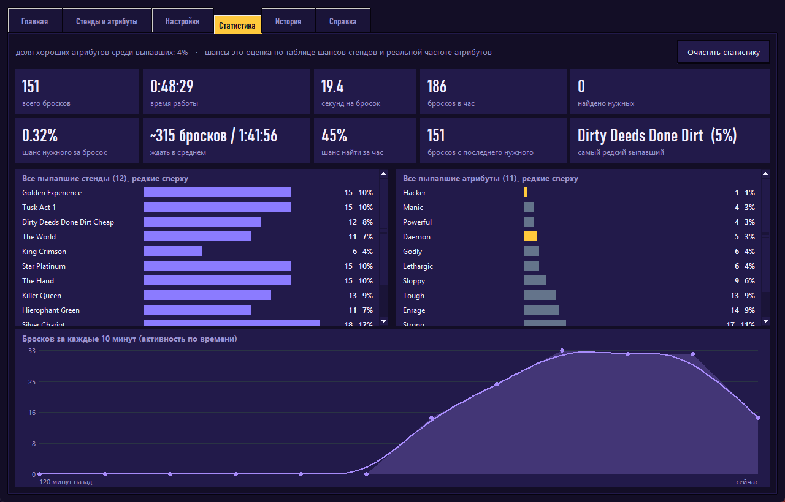
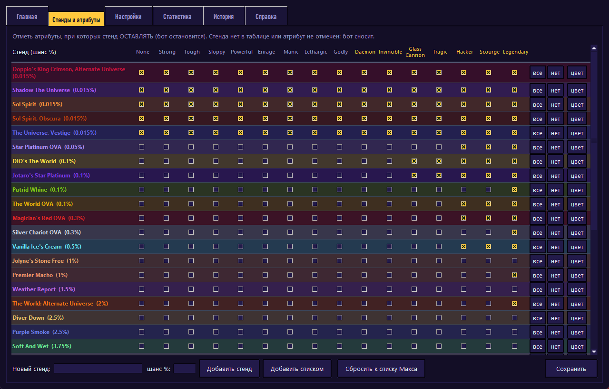

# Arrow Bot

Бот для Roblox «Stand Upright: Rebooted»: крутит стрелу, читает выпавший стенд и атрибут с экрана, нужное оставляет (пикнет и остановится), ненужное сносит фруктом Rokakaka и крутит дальше. Работает только через скриншоты, мышь и клавиатуру: в память игры не лезет и ничего в неё не внедряет.



## Что умеет

- **Читает экран.** Находит окно Roblox, сам ищет стрелу и Rokakaka в хотбаре по подписи внизу экрана (слот любой), распознаёт панель Stand/Attribute и окна подтверждения.
- **Решает по таблице.** Для каждого стенда вы отмечаете, при каких атрибутах его оставлять. Стенда нет в таблице или атрибут не отмечен: сносится. Неопознанное или похожее на нужное: бот останавливается и ничего не удаляет.
- **Стрелы по приоритету.** Сначала Charged Arrow, когда кончились, переходит на Stand Arrow. Порядок меняется в настройках.
- **Переживает вылеты.** Закрывает окно Changelogs, нажимает Play, при обрыве интернета жмёт Reconnect, ждёт, пока вы перезайдёте после ошибки 267 (сервер старше 3 часов).
- **Окно управления.** Старт и стоп, живые счётчики, пятиугольник «параметры забега», журнал, редактор таблицы стендов с цветами, настройки.
- **Статистика.** Каждый бросок записывается: вкладки «Статистика» (шансы, скорость, ожидание до нужного, графики) и «История» (список всех бросков, CSV для Excel).
- **Панель поверх игры.** Сквозная для мыши и скрытая от захвата экрана, поэтому бот её не читает.
- **Обновление одной кнопкой.** Кладёте новый архив в «Загрузки», нажимаете «Обновить»: правила, цвета и статистика остаются.







## Установка

Нужен Windows и Python 3.10–3.13 с pip и tkinter (с python.org).

1. Скачайте репозиторий и положите файлы в одну папку.
2. Запустите `install.bat`: он найдёт подходящий Python, поставит библиотеки и создаст ярлык «Arrow Bot» на рабочем столе.
3. Дальше запускайте ярлык (или `arrow_gui.pyw`), терминал не нужен.

Перед стартом: Roblox открыт, вы в игре; стрела и Rokakaka лежат в хотбаре. Играйте на приватном сервере, на публичном игра отключает через 3 часа. Roblox и бота запускайте с одинаковыми правами.

Остановка: кнопка «СТОП» или F7, пауза F6, мышь в левый верхний угол экрана.

Из командной строки: `python arrow_bot.py --yes` (работа), `python arrow_bot.py analyze` (показать, что бот видит, ничего не кликая).

## Как это устроено

- `arrow_bot.py`: логика бота. `Env` отвечает за окно, экран и ввод, `Bot` за решения, `parse_items` разбирает распознанный текст, `classify` применяет таблицу.
- Распознавание: rapidocr, настройки подбираются под установленную версию библиотеки и проверяются пробным запуском. Распознаются только нужные области экрана, поэтому круг занимает 10–20 секунд.
- Клики: Roblox не реагирует на нажатия `pyautogui`, поэтому основной способ это `SendInput` с абсолютными координатами.
- Перед удалением стенда бот ещё раз перечитывает панель за диалогом и жмёт Yes только после повторных совпадений.
- `arrow_gui.pyw`: окно (tkinter). Бот запускается подпроцессом, остановка идёт через файл-стоп.
- Настройки в `arrow_settings.json`, статистика в `arrow_bot_stats.jsonl`: оба файла создаются рядом с программой и в репозиторий не попадают.

## Тесты

`sim_test.py` (симулятор игры, сценарии: смерть, меню, перемешанные слоты, ошибки распознавания, переход между стрелами) и `stress_run.py N` (случайные прогоны, проверяют, что нужный стенд не удаляется). Обе команды пишут в консоль и не трогают ваш лог и статистику.

```
python sim_test.py
python stress_run.py 300
```

## Важно

Автокликеры формально против правил Roblox. Бан аккаунта возможен, всё на ваш риск. Проект не связан с Roblox и разработчиками игры. Для чужого аккаунта нужно разрешение владельца; пароли и коды бот не вводит и нигде не хранит.
